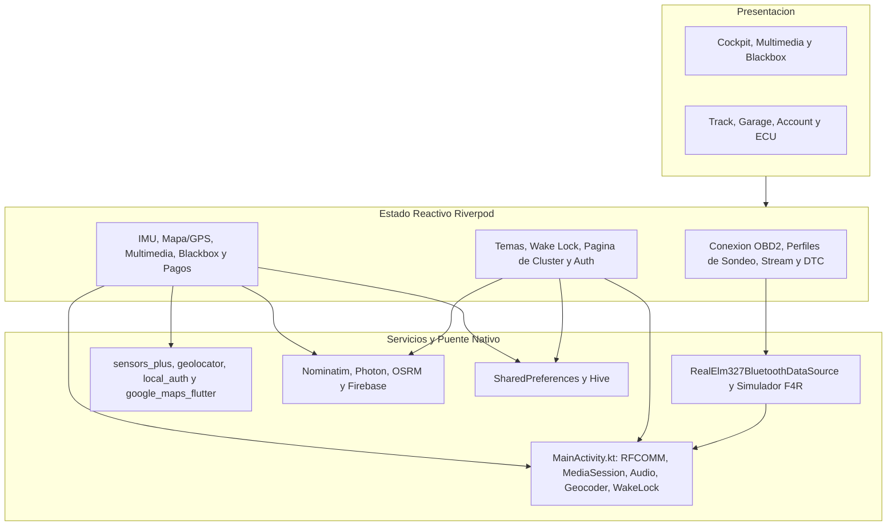
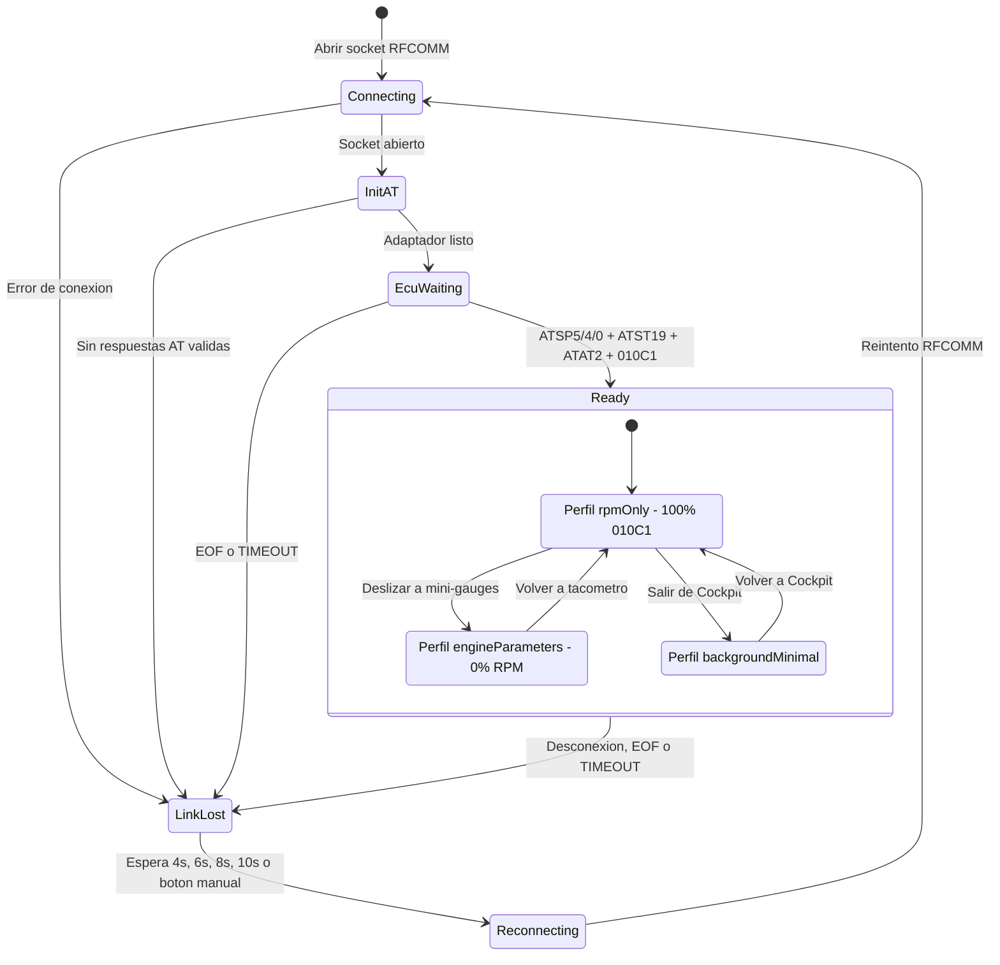

# Documentación Técnica: RS Digital Cockpit

- **Aplicación:** RS Digital Cockpit (`com.rs.digital.cockpit`, versión `2.0.5+173`)
- **Vehículo objetivo:** Renault Clio II Sport 172 Fase 2, modelo 2004, motor F4R 736 2.0L 16v y caja JC5-129
- **ECU y bus:** Siemens Sirius 34 sobre ISO 14230-4 KWP2000, Línea K a 10.4 kbps
- **Plataforma:** Android 17 / API 36, probado en Google Pixel Tablet y smartphone Android
- **Stack técnico:** Flutter 3, Dart 3, Flutter Riverpod y código nativo en Kotlin

---

## 1. Planteamiento del Proyecto

### 1.1 Contexto y problema

El Renault Clio II Sport 172 Fase 2 utiliza una electrónica previa a la adopción del bus CAN de alta velocidad. Su ECU Siemens Sirius 34 comunica por Línea K en el pin 7 del conector OBD-II a 10.4 kbps, lo que limita el tráfico real a unas 5 a 10 tramas por segundo. Cuando se usa un escáner móvil convencional que pide varios sensores en secuencia, el refresco de RPM cae por debajo de 2 Hz y el tacómetro pierde utilidad durante conducción rápida.

El cuadro analógico original tampoco muestra valores numéricos de presión de admisión, avance de encendido, carga del motor ni temperatura de aire de admisión, y no guarda registro de sesiones. Además, el motor F4R 736 cambia su régimen recomendado según la temperatura del refrigerante: por debajo de 75 °C conviene limitar el motor a 5,000 RPM; ya en temperatura operativa entra el decalador VVT a partir de 5,150 RPM con carga igual o mayor a 50%, el testigo verde de cambio enciende a 6,750 RPM y el corte llega a 7,250 RPM.

A esto se suman problemas cotidianos en cabina. Alternar entre una app de OBD-II, el reproductor de música y el navegador distrae al conducir, el tráfico continuo del adaptador Bluetooth interfiere con el audio si no puede apagarse por software y las interfaces pensadas solo para tablet suelen romperse en teléfono.

### 1.2 Objetivos

El objetivo general es desarrollar una aplicación móvil y *Car Launcher* para Android en Flutter y Kotlin que concentre telemetría OBD-II KWP2000 para la ECU Siemens Sirius 34, control multimedia del sistema, navegación con registro de vueltas, sensores inerciales y sincronización con Firebase bajo un manejo de estado reactivo en Riverpod.

Objetivos específicos:
- Maximizar la fluidez del tacómetro sobre Línea K separando el sondeo de RPM del resto de sensores del motor y detectando caídas reales del enlace Bluetooth con reconexión automática.
- Incluir un simulador físico basado en la caja JC5-129 y el comportamiento térmico del motor F4R 736 para trabajar y probar la interfaz fuera del automóvil.
- Diseñar una interfaz legible de día y de noche que se adapte sin desbordamientos a tablet horizontal y a smartphone.
- Integrar directamente las APIs nativas de Android necesarias para Bluetooth RFCOMM, sesiones multimedia, control de volumen silencioso, geocodificación y bloqueo de reposo de pantalla.
- Integrar autenticación, almacenamiento de sesiones en la nube, control de funciones por nivel de suscripción y validación biométrica en acciones sensibles.

### 1.3 Alcance funcional

Al iniciar la aplicación se ejecuta una pantalla de arranque con el emblema Renault Sport y un recorrido inicial de 4 pasos guardado localmente. El menú principal organiza la operación en 7 módulos:

| Módulo | Componentes principales | Función |
| :--- | :--- | :--- |
| `COCKPIT` | `CockpitDashboardScreen`, `RenaultSportTachometerWidget`, `EngineMiniGaugesWidget`, `GForceBallWidget` | Tablero principal con tarjeta deslizable entre el tacómetro solo de RPM y los 6 mini-gauges de motor, monitor de Fuerzas G calibrable y minimapa GPS con reflejo de la ruta activa. |
| `MULTIMEDIA` | `MultimediaHubScreen`, `RsMediaNotificationListenerService` | Control del reproductor activo en Android con carátula de fondo adaptada al tema, barra de progreso interactiva, volumen sin ventana emergente y botón `ATT` de atenuación rápida. |
| `BLACKBOX` | `BlackboxHubScreen`, `BlackboxRealtimeNotifier` | Estado de sincronización con Firebase, picos de la sesión actual con guardado y reinicio manual, resumen de vueltas GPS e historial de sesiones con eliminación. |
| `TRACK` | `TrackMapScreen`, `TrackMapTelemetryNotifier` | Mapa de navegación con búsqueda cercana de talleres, gasolineras y estacionamientos, cálculo de rutas vehiculares y cronómetro automático de vueltas GPS. |
| `GARAGE` | `DigitalGarageScreen`, `DigitalGaragePaymentNotifier` | Gestión de los 3 planes de suscripción, cambio de estilos del clúster, catálogo de refacciones OEM del motor F4R y pago validado con Luhn y biometría. |
| `ACCOUNT` | `PilotProfileScreen`, `PilotAuthNotifier`, `FcmTopicsNotifier` | Perfil del piloto, odómetro automático alimentado por GPS y velocidad OBD-II, ajuste manual de kilometraje y recordatorios de servicio en notificaciones de Android. |
| `ECU` | `DtcDiagnosticSheet`, `ObdConnectionModeNotifier`, `RealElm327BluetoothDataSource` | Encendido y apagado del enlace `ECU ON/OFF`, selector modal de dispositivos Bluetooth vinculados, cambio a simulador, lectura y borrado de DTC, reconexión manual y consola serial KWP2000. |

---

## 2. Arquitectura de Software

### 2.1 Organización y manejo de estado

El código sigue una estructura *Feature-First* dividida por dominio funcional. Toda la gestión de estado se implementa con `flutter_riverpod` mediante `Notifier`, `AsyncNotifier` y `StreamProvider`, sin usar `setState`, `ValueNotifier` ni `StatefulWidget` en ningún archivo de `lib/`.

- **Capa de presentación:** pantallas y widgets basados exclusivamente en `ConsumerWidget` y `StatelessWidget`, suscritos de forma selectiva con `ref.watch` y `.select(...)` para reducir reconstrucciones innecesarias durante las actualizaciones rápidas del tablero.
- **Capa de estado:** clases inmutables por módulo como `ObdTelemetryFrame`, `ObdAdapterState`, `TrackMapTelemetryState`, `GForceTelemetryState`, `MultimediaHubState` y `BlackboxCloudRecord`, con liberación de recursos en `ref.onDispose`.
- **Capa de datos y código nativo:** abstracción polimórfica `ObdDataSource` para alternar entre el adaptador real y el simulador, clientes HTTP para servicios geoespaciales, integración con Firebase y puente `MethodChannel` hacia `MainActivity.kt`.

### 2.2 Diagrama de arquitectura



### 2.3 Estructura del código fuente

```text
lib/
├── main.dart                                   # Arranque, Firebase, ProviderScope y wake lock
├── firebase_options.dart                       # Configuración Firebase Android
├── core/
│   ├── launcher/car_launcher_service.dart      # Lanzador de apps externas y Home Launcher
│   └── theme/                                  # Paleta Renault Sport, skins y ThemeModeNotifier
└── features/
    ├── splash/rs_splash_screen.dart            # Pantalla de inicio vectorial
    ├── onboarding/                             # Flujo inicial de 4 pasos
    ├── auth_profile/                           # Autenticación, verificación de correo y perfil
    ├── cockpit_dashboard/
    │   ├── cockpit_dashboard_screen.dart       # Cabecera, clúster deslizable y navegación entre módulos
    │   └── widgets/
    │       ├── launcher_dock_widget.dart       # Dock adaptable de 7 pestañas y política WakeLock
    │       └── dtc_diagnostic_sheet.dart       # Panel ECU, estado de enlace, Bluetooth y DTC
    ├── telemetry/
    │   ├── models/obd_telemetry_frame.dart     # Modelos de trama, Shift-Light y fallas DTC
    │   ├── providers/telemetry_providers.dart  # Estado OBD2, reconexión, perfiles y stream
    │   ├── services/elm327_service.dart        # Contrato ObdDataSource, parser KWP2000, ELM327 y simulador
    │   └── widgets/                            # Tacómetro, 6 mini-gauges y monitor de Fuerzas G
    ├── multimedia/multimedia_hub_screen.dart   # Reproductor nativo, filtro por tema y control ATT
    ├── map_track/                              # Mapa, búsqueda cercana, ruteo OSRM y laps GPS
    ├── digital_garage_payments/                # Planes, catálogo OEM y validador Luhn
    ├── cloud_sync_fcm/                         # BlackboxHubScreen, cliente RTDB REST+SDK y notificaciones
    └── sensors/                                # Acelerómetro/giroscopio y biometría local_auth
android/app/src/main/kotlin/com/rs/digital/cockpit/
└── MainActivity.kt                             # RFCOMM SPP, MediaSession, AudioManager, Geocoder y WakeLock
```

### 2.4 Diseño de interfaz y reglas de negocio

- **Temas y tipografía:** soporta modo automático del sistema, oscuro y claro. Las cifras dinámicas usan `FontFeature.tabularFigures()` con `Chakra Petch` y `Orbitron` para que los números no vibren horizontalmente al cambiar rápido.
- **Adaptación a tablet y teléfono:** en tablet horizontal a partir de 840 × 480 px, `COCKPIT` usa dos columnas en proporción 8 a 3: a la izquierda la tarjeta principal deslizable entre el tacómetro y la rejilla radial de 6 mini-gauges, y a la derecha Fuerzas G y el minimapa. En smartphone pasa a columna desplazable, la rejilla cambia de 3×2 a 2×3 debajo de 520 px de ancho y el dock inferior mide con `TextPainter` el espacio disponible para mostrar solo iconos si las 7 etiquetas no caben.
- **Reglas de cuenta y seguridad:** el acceso acepta correo con contraseña, Google y GitHub. Las cuentas por correo deben verificar su dirección antes de entrar al tablero y son las únicas que permiten subir foto de perfil a Firebase Storage; las cuentas OAuth conservan el avatar de su proveedor.
- **Suscripciones y pagos:** los niveles se guardan en `SharedPreferences` y controlan el acceso a funciones avanzadas:
  - `RS Clubman`, gratuito: telemetría básica K-Line, Shift-Light térmico, Blackbox y simulador.
  - `RS Cup Telemetry`, \$99 MXN/mes: PIDs extendidos Sirius 34 de presión MAP, avance y carga, más alertas de servicio por kilometraje.
  - `RS Trophy Pro`, \$899 MXN/año: estilos adicionales del tablero, cronómetro de vueltas GPS, monitor de Fuerzas G y lectura/borrado de DTC.
  - Tanto la activación de planes de pago como el carrito de refacciones validan la tarjeta con el algoritmo de Luhn, fecha `MM/YY` y CVV antes de exigir huella o credencial nativa con `local_auth` y guardar la orden en `garage_orders/{uid}/{orderId}`.

---

## 3. Uso de Sensores y Componentes

### 3.1 Matriz de hardware, sensores y servicios

| Subsistema | API o paquete | Frecuencia / canal | Uso en la aplicación |
| :--- | :--- | :--- | :--- |
| Bus OBD-II ELM327 | `BluetoothSocket` RFCOMM SPP | Canal `rfcomm`, lectura cada 1 ms | Handshake KWP2000, lectura por perfiles exclusivos, fallas Modo `03`, borrado Modo `04` y desconexión física. |
| Acelerómetro y giroscopio | `sensors_plus` | ~50 Hz (`gameInterval`) | Cálculo de fuerzas laterales y longitudinales calibradas, filtro EMA y velocidad angular yaw. |
| Receptor GPS | `geolocator` | Cada 400 ms, filtro 0 m | Posición y rumbo del minimapa, odómetro automático Haversine y detección de vueltas. |
| Mapas y geodatos | `google_maps_flutter`, `Geocoder`, Nominatim, Photon, OSRM | Bajo demanda y calle cada 15 s | Mapa acorde al tema, puntos de interés cercanos, trazado de ruta en Track y Cockpit, y nombre de calle para vueltas. |
| Multimedia y audio | `MediaSessionManager`, `NotificationListenerService`, `AudioManager` | Sondeo 700 ms y broadcast de apps | Metadatos y carátula comprimida a máximo 600 px, controles de reproducción, volumen silencioso y botón `ATT`. |
| Biometría | `local_auth`, `HapticFeedback` | Bajo demanda | Autorización de pagos, activación de planes y borrado de códigos DTC. |
| Control de pantalla | `FLAG_KEEP_SCREEN_ON` | Canal `launcher` | Mantiene la pantalla encendida en `COCKPIT`, `MULTIMEDIA` y `ECU`, y permite el reposo en las demás pestañas. |
| Nube y alertas | Firebase Auth, RTDB, Storage, FCM y `flutter_local_notifications` | Eventos en vivo y caché local | Sincronización de Blackbox y vueltas GPS, respaldo offline y alertas locales de mantenimiento F4R. |

### 3.2 Ingeniería del protocolo OBD-II KWP2000

La comunicación serie Bluetooth corre en un hilo dedicado dentro de `MainActivity.kt` protegido por bloqueo de entrada/salida, mientras que Dart encola cada petición para evitar colisiones entre la telemetría continua y el diagnóstico Modo `03` o `04`.

1. **Control real de socket en Kotlin:** al conectar se intenta apertura RFCOMM segura y luego insegura; si ambas fallan, el socket se cierra de inmediato. Antes y durante cada comando se comprueba `isConnected`, se captura fin de flujo `bytesRead < 0` cerrando el socket ante errores de E/S y se devuelve la marca `"TIMEOUT"` si vence el plazo sin recibir el carácter `>` ni datos válidos.
2. **Validación de inicialización y recuperación:** tras abrir el puerto se envía la secuencia `ATZ`, `ATE0`, `ATL0`, `ATS0`, `ATH0` y `ATAT1`. Si no llegan respuestas AT válidas, la sesión se aborta en lugar de marcar conexión activa. Con el adaptador verificado se negocia el bus en orden `ATSP5`, `ATSP4` y `ATSP0`, y una vez que responde la ECU se activa el modo rápido con `ATST19`, `ATAT2` y petición de trama única `010C1`, evitando la espera de 200 ms por una segunda centralita inexistente.
3. **Estados de enlace y reconexión:** el servicio publica el estado real mediante `ObdLinkStatus` con los valores `disconnected`, `connecting`, `adapterConnectedEcuWaiting`, `connectedEcuReady` y `reconnecting`. Solo `connectedEcuReady` muestra el indicador `OK`. Si se pierde el adaptador o hay timeout crítico, se detienen las tramas congeladas y el controlador programa reintentos escalonados a los 4, 6, 8 y 10 segundos, además del botón `RECONECTAR AHORA` en el panel ECU.
4. **Perfiles exclusivos de sondeo:** para no repartir los 10.4 kbps entre datos que no están en pantalla, el bucle cambia dinámicamente según la vista visible:
   - `rpmOnly`: activo en la tarjeta del tacómetro; dedica el 100% del bus a `010C1`.
   - `engineParameters`: activo al deslizar a los 6 mini-gauges; detiene por completo las consultas de RPM y rota solo sensores del motor (`0105`, `0111`, `ATRV`, `010F`, y en planes de pago `010B`, `010E` y `0104`).
   - `backgroundMinimal`: reduce el tráfico al mínimo cuando el usuario está fuera de `COCKPIT`.

| PID / Comando | Variable | Fórmula | Uso principal |
| :--- | :--- | :--- | :--- |
| `010C` / `010C1` | Revoluciones | $\text{RPM} = \frac{(A \times 256) + B}{4}$ | Aguja de tacómetro, Shift-Light y VVT |
| `010D` | Velocidad | $v = A\ \text{km/h}$ | Velocidad, 0 a 100 km/h y odómetro |
| `0111` | Mariposa TPS | $\text{TPS} = \frac{A \times 100}{255}\%$ | Mini-gauge de acelerador |
| `0105` | Refrigerante | $T_{\text{ECT}} = A - 40\ ^\circ\text{C}$ | Cambio entre mapa frío y caliente |
| `010B` | Presión MAP | $\text{MAP} = A\ \text{kPa}$ | Mini-gauge extendido |
| `010E` | Avance encendido | $\theta = \frac{A}{2} - 64^\circ$ | Mini-gauge extendido |
| `0104` | Carga motor | $\text{Carga} = \frac{A \times 100}{255}\%$ | Mini-gauge extendido y condición VVT |
| `010F` | Aire admisión IAT | $T_{\text{IAT}} = A - 40\ ^\circ\text{C}$ | Lectura combinada en tarjeta de batería |
| `ATRV` / `0142` | Voltaje batería | Lectura directa o $\frac{(A\times 256)+B}{1000}$ | Estado de batería y alternador |
| `03` / `04` | Códigos DTC | Pares hex tras cabecera `43` | Lectura real sin falsos códigos y borrado |



### 3.3 Procesamiento de sensores inerciales, audio y GPS

**Fuerzas G con filtro EMA:** las vibraciones del motor y la suspensión generan ruido en el acelerómetro. `GForceSensorNotifier` resta el punto cero calibrado guardado en `SharedPreferences`, acota el rango a ±1.8 G, aplica una zona muerta de 0.02 G y suaviza la señal con un filtro exponencial de factor $\alpha = 0.20$:

$$G_{\text{cal}}[k] = \text{clamp}\!\left(\frac{a_{\text{raw}}[k]}{g_0} - G_0,\;-1.8,\;1.8\right), \qquad g_0 = 9.80665\ \text{m/s}^2$$

$$G_{\text{filtrado}}[k] = G_{\text{filtrado}}[k-1] + 0.20 \cdot \left(G_{\text{cal}}[k] - G_{\text{filtrado}}[k-1]\right)$$

$$\|G\| = \sqrt{G_{\text{lat}}^2 + G_{\text{lon}}^2}$$

**Volumen silencioso y botón `ATT`:** el deslizador de volumen llama a `AudioManager.setStreamVolume` con `flags = 0` para no superponer el control nativo de Android sobre el tablero. Al pulsar `ATT`, se lee el paso discreto real del dispositivo y se calcula el nivel reducido garantizando que nunca aumente en volúmenes bajos:

$$\text{targetStep} = \begin{cases} 0 & \text{si } s_{\text{actual}} \le 0 \\ \text{clamp}\!\left(\text{round}(0.25 \cdot s_{\text{actual}}),\;0,\;s_{\text{actual}} - 1\right) & \text{si } s_{\text{actual}} > 0 \end{cases}$$

**Minimapa, ruteo abierto y cronómetro de vueltas:** el GPS solicita lecturas cada 400 ms y orienta la cámara del minimapa a zoom 17.2 e inclinación de 35° cuando la velocidad supera 1.2 m/s bajo un indicador central fijo. Para prescindir de APIs comerciales de Places y Directions, los puntos cercanos se consultan en Nominatim y Photon, mientras las rutas vehiculares se calculan en OSRM y se dibujan simultáneamente en `TRACK` y en el minimapa de `COCKPIT`. El cronómetro de vueltas obtiene el nombre de la calle mediante `Geocoder`, arma la vuelta al superar 35 m desde el punto de salida y registra el tiempo al volver a menos de 25 m tras un mínimo de 8 s, enviando la sesión a `track_lap_sessions/{uid}`.

---

## 4. Proceso de Desarrollo

### 4.1 Etapas de desarrollo

El proyecto avanzó de forma incremental, validando cada bloque en Google Pixel Tablet, smartphone Android y el Renault Clio RS 172 con adaptador ELM327:

1. **Base de la aplicación y temas:** configuración de Flutter, permisos de Android 17, soporte como *Car Launcher*, paleta de colores claro/oscuro/sistema, pantalla de arranque y recorrido inicial.
2. **Núcleo de telemetría y servicios iniciales:** contrato `ObdDataSource`, simulador físico F4R/JC5-129, instrumentos en `CustomPainter`, integración con Firebase, mapas, validador Luhn y actualización de Gradle a AGP 9.1.0 con Kotlin 2.4.0.
3. **Pruebas en vehículo real:** ajuste de tiempos de inicialización KWP2000 sobre la Sirius 34, corrección del parser Modo `03` para eliminar códigos inventados e incorporación de `010C1`, `ATST19`, `ATAT2` y lectura RFCOMM en bloques de 1 ms.
4. **Cabina conectada y adaptación a teléfono:** control multimedia nativo con carátula y botón `ATT`, calibración de Fuerzas G, ruteo OSRM reflejado en minimapa, cronómetro GPS, odómetro automático con alertas locales, selector modal Bluetooth, política `FLAG_KEEP_SCREEN_ON` y ajustes responsivos para eliminar desbordamientos en vertical.
5. **Aislamiento de ancho de banda y recuperación real OBD-II:** rediseño de `COCKPIT` con tarjeta deslizable para separar al 100% las RPM de los 6 mini-gauges, separación de `BLACKBOX` en su propia pestaña y reconstrucción de la capa RFCOMM/ELM327 para detectar desconexiones reales y reconectar progresivamente.

### 4.2 Retos técnicos y soluciones aplicadas

| Problema encontrado | Causa raíz | Solución aplicada |
| :--- | :--- | :--- |
| Tacómetro por debajo de 2 Hz con ELM327 real | Petición secuencial de todos los PIDs y espera de 200 ms por una segunda ECU en Línea K. | Trama única `010C1`, `ATST19`, `ATAT2`, lectura nativa cada 1 ms y perfil exclusivo `rpmOnly` en la tarjeta del tacómetro. |
| Competencia de bus entre RPM y parámetros del motor | Mezclar sensores secundarios en el mismo ciclo degradaba la respuesta sobre 10.4 kbps. | Tarjeta deslizable que cambia automáticamente entre `rpmOnly` y `engineParameters` según la vista activa. |
| Falso estado `OK` desconectado y bloqueo tras timeout | Un puerto abierto sin respuestas AT o un timeout inicial no cerraba la sesión ni reintentaba. | Validación estricta de respuestas AT, control de `isConnected`/EOF/`"TIMEOUT"` en Kotlin, estados `ObdLinkStatus` y reconexión progresiva de 4 a 10 s con botón manual. |
| Interferencia Bluetooth con la música | Tráfico RFCOMM constante aun cuando no se necesitaba diagnóstico. | Interruptor persistente `ECU ON/OFF` que cierra el socket y perfil `backgroundMinimal` fuera de `COCKPIT`. |
| Desbordamientos de UI en smartphone | Contenedores dimensionados para pantalla de tablet horizontal. | Rejillas dinámicas con `LayoutBuilder`, escalado proporcional en el tacómetro y dock con cambio automático a solo iconos. |
| Desfase del marcador GPS en el minimapa | Frecuencia de actualización por defecto demasiado baja respecto al movimiento del coche. | Configuración `AndroidSettings` a 400 ms con cámara rotativa por rumbo y marcador central fijo. |
| Botón `ATT` subía el volumen en niveles bajos | Umbral de respaldo que reemplazaba valores pequeños antes de dividir. | Lectura directa del paso discreto del sistema y cálculo acotado al rango `0` a `currentStep - 1`. |
| Timeout de 10 s al sincronizar Blackbox Cloud | Instancia RTDB no creada devolviendo HTTP 404 mientras el SDK WebSocket seguía reintentando. | Sondeo previo vía REST autenticado con respuesta menor a 1 s y diagnóstico claro antes de abrir la suscripción en vivo. |

### 4.3 Verificación y compilación

Las comprobaciones finales sobre la versión integrada arrojaron los siguientes resultados:

1. **Auditoría de estado Riverpod:** 0 ocurrencias de `setState`, `ValueNotifier` y `StatefulWidget` en todo el directorio `lib/`.
2. **Análisis estático:** `flutter analyze` finalizó sin errores ni advertencias.
3. **Pruebas unitarias:** `flutter test` sobre `test/sirius34_kwp_luhn_test.dart` aprobó 4 de 4 pruebas, cubriendo decodificación KWP2000 y Modo `03`, umbrales de Shift-Light en frío y caliente, permiso de edición de avatar por proveedor de Firebase Auth y validación Luhn.
4. **Compilación Android:** `flutter build apk --debug` generó correctamente el instalador `build/app/outputs/flutter-apk/RS-Digital-Cockpit.apk`.

---

## 5. Conclusiones

1. El desarrollo confirma que un bus serial antiguo de 10.4 kbps como la Línea K de la Siemens Sirius 34 permite una lectura fluida de RPM si la comunicación se diseña en función de sus límites físicos, aislando las peticiones por perfil, reduciendo tiempos muertos del ELM327 y gestionando de forma real las desconexiones.
2. Mantener los 7 módulos y el ciclo de vida de sensores, Bluetooth, audio, GPS y nube bajo Riverpod puro facilitó depurar errores encontrados en pruebas reales y evitó fugas de recursos al cambiar de pantalla.
3. Combinar Flutter para el dibujo de instrumentos con un puente nativo compacto en Kotlin resolvió requisitos que los paquetes multiplataforma no cubren bien por sí solos, como la captura de carátulas del sistema, el volumen silencioso, el control del socket RFCOMM y el manejo selectivo de pantalla encendida.
4. Probar fuera del emulador, tanto en tablet y teléfono como dentro y fuera del Clio RS 172, resultó decisivo para detectar fallos que no aparecen en escritorio, entre ellos los desbordamientos verticales, la deriva del GPS, el comportamiento del botón `ATT` en pasos bajos y los falsos estados de conexión OBD-II.

### Trabajo futuro

- Habilitar la instancia productiva de Firebase Realtime Database y Storage con reglas por `$uid` para sincronización entre dispositivos.
- Incorporar comandos propietarios Renault KWP2000 para leer parámetros internos adicionales de la Sirius 34.
- Añadir exportación de telemetría en CSV/GPX y empaquetado *release* firmado para uso continuo en pista.
